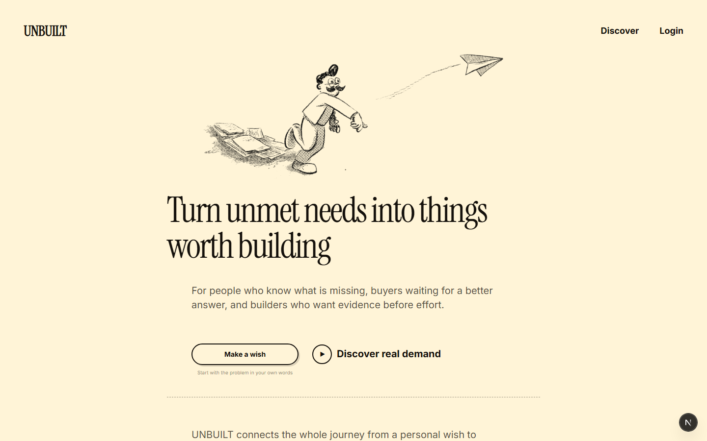
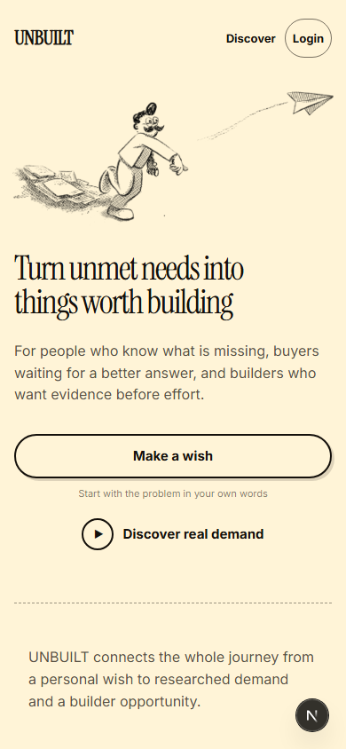
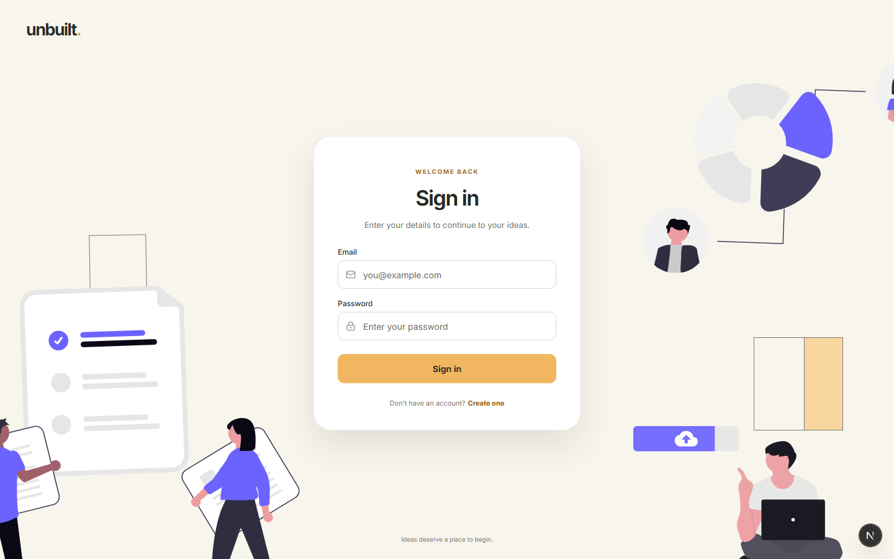
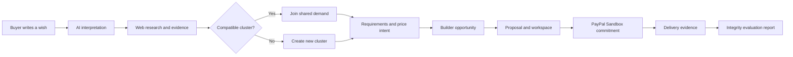
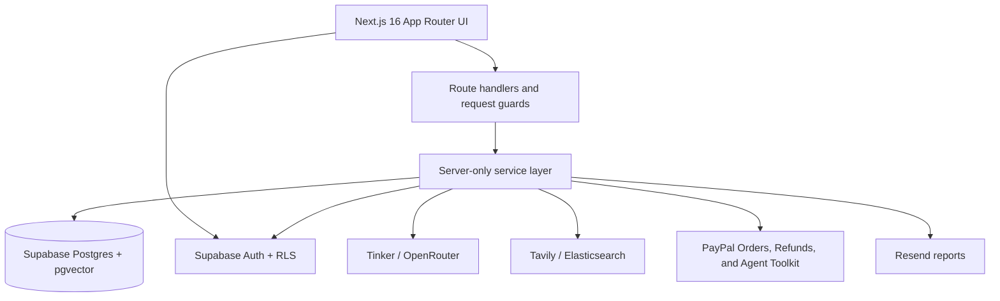
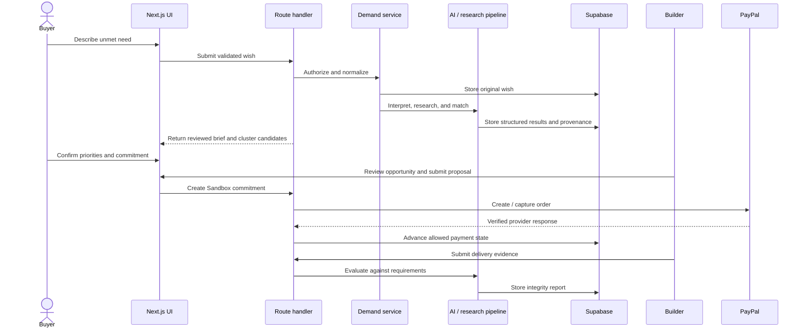

# UNBUILT

> **The market for things that do not exist. Yet.**

UNBUILT is a demand-first product marketplace. Buyers describe something they wish existed, AI researches and structures the need, related requests form demand clusters, and builders discover opportunities backed by evidence and payment intent.

[](https://unbuilt-xsl3.onrender.com)
[](https://nextjs.org/)
[](https://supabase.com/)
[](https://developer.paypal.com/)

## Table of contents

- [Product preview](#product-preview)
- [Why UNBUILT exists](#why-unbuilt-exists)
- [Product and engineering approach](#product-and-engineering-approach)
- [Core experiences](#core-experiences)
- [How it works](#how-it-works)
- [AI and research pipeline](#ai-and-research-pipeline)
- [Payment-backed trust](#payment-backed-trust)
- [Architecture](#architecture)
- [Technology stack](#technology-stack)
- [Quick start](#quick-start)
- [Environment configuration](#environment-configuration)
- [Production setup](#supabase-production-setup)
- [Testing strategy](#testing-strategy)
- [Security model](#security-model)
- [Known limitations](#known-limitations)
- [Roadmap](#roadmap)

## Product preview

### Landing page



<table>
  <tr>
    <td width="34%" valign="top">
      <strong>Responsive mobile experience</strong><br><br>
      
    </td>
    <td width="66%" valign="top">
      <strong>Focused authentication</strong><br><br>
      
    </td>
  </tr>
</table>

## Why UNBUILT exists

Builders often spend weeks creating a product before discovering that the demand was weak. Meanwhile, people with genuine unmet needs have no structured way to explain the problem, find others who share it, and show that they would actually pay for a solution.

UNBUILT changes the order:

1. **Start with the problem.** A buyer writes a wish in normal language.
2. **Research before publishing.** AI investigates existing approaches, alternatives, gaps, risks, and likely requirements.
3. **Find shared demand.** Related wishes are matched into demand clusters without merging incompatible constraints.
4. **Measure meaningful intent.** Buyers can state priorities, price intent, and make a refundable PayPal Sandbox commitment.
5. **Give builders evidence.** Builders see the researched brief, consensus requirements, activity, and buyer intent before committing effort.
6. **Evaluate delivery.** Builder submissions are checked against the agreed requirements and produce a structured integrity report.

The result is not another idea board. It is a path from an unmet need to researched demand, a builder opportunity, and a payment-verifiable commitment.

## Product and engineering approach

This section records the reasoning behind the product, the major technical decisions, the tradeoffs that were accepted, and the guardrails used while building it. It is an architectural decision narrative, not a transcript of private implementation reasoning.

### 1. Begin with demand, not an idea catalogue

The central product decision was to make the **problem** the primary object. Traditional idea directories usually begin with a proposed solution and ask people to vote for it. That creates three problems:

- early wording anchors everyone to one solution;
- upvotes are easy to give and weak as purchase evidence;
- builders still have to guess which part of the idea people actually value.

UNBUILT therefore stores the buyer's original wish, a structured interpretation, explicit constraints, shared requirements, and price intent separately. A builder can understand both the raw problem and the normalized demand without treating the AI summary as the original truth.

### 2. Separate interpretation, research, and matching

One giant AI prompt would be simple to implement but difficult to inspect, retry, or trust. The workflow is split into distinct responsibilities:

| Stage | Question it answers | Output |
|---|---|---|
| Interpretation | What is this person actually asking for? | Outcome, audience, constraints, category, capabilities, price references |
| Research | What already exists and what remains unresolved? | Alternatives, competitors, evidence, gaps, risks, source links |
| Matching | Is this compatible with an existing demand cluster? | Ranked candidates, confidence, explanation, conflicting constraints |
| Synthesis | What do participants agree on? | Consensus requirements and cluster summary |
| Integrity evaluation | Does a submitted delivery address the agreed scope? | Requirement-by-requirement findings and report status |

This separation makes failures local. Research can be retried without changing the original interpretation, and a matching result can be reviewed without regenerating the market analysis.

### 3. Preserve user control over AI output

AI is used to reduce ambiguity, not to replace the buyer. The buyer sees the structured brief before the wish becomes builder-facing and can correct what the model misunderstood.

The system follows these rules:

- preserve the original user text;
- distinguish sourced evidence from model hypotheses;
- retain provider and run metadata for operational review;
- label fallback behavior instead of pretending it came from a model;
- never allow AI output to authorize money movement;
- make important requirements visible and editable before commitment.

### 4. Combine semantic similarity with hard constraints

Embeddings are helpful for finding wishes that use different vocabulary, but similarity alone can create harmful merges. “Offline only” and “cloud hosted” may describe the same general category while requiring incompatible products.

The matcher therefore uses two layers:

1. **Semantic retrieval** finds plausible candidates.
2. **Deterministic compatibility checks** reject or downgrade candidates with conflicting constraints.

Scores determine whether a candidate is safe to join, should be shown for user review, or should be ignored. Local hash embeddings keep the flow operational when a hosted embedding model is unavailable.

### 5. Treat demand as several signals, not one number

A single score hides too much. UNBUILT keeps different signals visible:

- distinct interested buyers;
- price-qualified buyers;
- financially verified Sandbox commitments;
- feature priorities and votes;
- confidence and evidence quality;
- active proposals and builder activity.

This prevents a large number of casual clicks from being presented as equivalent to a smaller number of people who stated a price or completed a Sandbox commitment.

### 6. Introduce payment only after the requirement is understandable

Charging at the first text box would create pressure before the buyer knows what they are supporting. The product first structures the wish, researches alternatives, presents the likely demand cluster, and confirms priorities. Payment intent comes after the scope is visible.

The current payment is a refundable PayPal Sandbox commitment. It demonstrates a trust mechanism without silently enabling live commerce. Live mode requires an explicit environment switch in addition to live credentials.

### 7. Make the server authoritative for money

The browser can request an operation, but it cannot declare that a payment succeeded. The server owns:

- the amount and currency;
- the PayPal order body;
- internal payment identifiers;
- idempotency keys;
- capture and refund calls;
- allowed payment-state transitions;
- reconciliation and webhook verification.

Every PayPal response is checked against stored expectations. This is why changing text in the browser or faking a success callback cannot create a completed payment record.

### 8. Evaluate delivery against the agreed scope

A payment commitment is not enough if builders can claim completion without evidence. The builder workspace therefore leads to a structured integrity submission. Evidence is compared with the requirements associated with the opportunity.

The evaluation report is designed to answer:

- which requirements appear satisfied;
- which requirements are incomplete or unsupported;
- what evidence was provided;
- where confidence is low;
- whether human review is still necessary.

The report informs the workflow but does not automatically make irreversible financial decisions.

### 9. Keep optional integrations optional

Sponsor APIs, research providers, model providers, search infrastructure, and email delivery should improve the app without becoming single points of failure.

The resilience order is:

```text
preferred provider → configured fallback → deterministic local behavior → clear unavailable state
```

Examples:

- Tinker can fall back to OpenRouter or local heuristics.
- Hosted embeddings can fall back to local hash embeddings.
- Elasticsearch improves evidence retrieval but does not own the source of truth.
- Resend failure does not hide a report that is already stored in the application.
- Missing PayPal credentials disable checkout visibly instead of simulating a transaction.

### 10. Use the database as a second authorization boundary

Page redirects improve the experience but are not security controls by themselves. Authorization is repeated in route handlers and services, while Supabase row-level security protects data at the database boundary.

The browser receives only the public Supabase key. Service-role access stays in server-only modules. Roles such as administrator cannot be assigned through the signup form.

### 11. Design the interface around progressive disclosure

The platform contains research, demand signals, proposals, payments, integrity checks, and operational state. Showing everything at once would make the product feel like an admin console.

The interface instead reveals complexity in stages:

- the landing page explains the value before technical details;
- the wish flow opens later fields only after the previous stage is complete;
- research uses waiting states while the backend works;
- demand pages organize evidence and activity into focused sections;
- builder tools appear only where the user's role and opportunity require them;
- detailed reports open intentionally instead of filling the main workspace.

Mobile layouts use a single-column reading order, large touch targets, fluid illustrations, and navigation that does not overlap page content.

### 12. Make background work observable

Long-running research should not look like a frozen form. AI runs and operational records make it possible to distinguish pending, successful, fallback, and failed work. User-facing loading states explain that analysis is still happening, while administrative health views show capabilities without printing secrets.

### 13. Prefer explicit states over ambiguous booleans

Payments, research jobs, proposals, and reports have lifecycles rather than simple yes/no values. Explicit status values make retries and failure recovery safer. For payments in particular, transitions are conditional and constrained so two concurrent requests cannot freely overwrite one another.

### 14. Keep generated and real data distinguishable

Local seeds are useful for demos and testing, but invented marketplace activity must not be presented as real demand. Seeded records are labelled as demo data, and seed scripts do not fabricate PayPal transactions. A completed payment row must originate from an actual Sandbox flow or a controlled automated test transport.

### 15. Optimize for a credible prototype, then expose limitations

The project chooses depth in the central journey over a large collection of unfinished buttons. Features that are not complete are kept in the roadmap rather than represented as working product capabilities. The README also states the current merchant model, currency limit, Sandbox status, provider dependencies, and free-hosting constraints.

## Core experiences

### For buyers

- Submit a wish through a guided multi-step flow.
- Review and correct the AI-generated problem brief.
- See existing products, competing approaches, evidence, and unresolved gaps.
- Join a related demand cluster or create a new one.
- Vote on requirements and express price-qualified interest.
- Use PayPal Sandbox to make a refundable commitment.
- Follow proposals, build updates, notifications, payments, and reports.

### For builders

- Browse researched demand instead of guessing what to build.
- Filter opportunities and compare demand signals.
- Review cluster requirements, evidence, buyer priorities, and constraints.
- Submit proposals and publish product offers.
- Work from a dedicated builder workspace.
- Submit delivery evidence for integrity evaluation.
- View the resulting evaluation report and payment status.

### For administrators

- Review moderation and integrity flags.
- Inspect AI runs and system capability health.
- Merge or split demand clusters.
- Review proposals and payment reconciliation status.
- Keep privileged actions behind server-side role checks.

## How it works



## AI and research pipeline

Free-text wishes rarely use the same vocabulary. One person may ask for “an offline coding copilot,” while another asks for “a private local-model assistant.” UNBUILT turns those descriptions into comparable structured intent.

The pipeline combines:

- **Tinker** as the primary OpenAI-compatible reasoning provider.
- **OpenRouter** as an optional model fallback.
- **Tavily** for current external research.
- **Elasticsearch** for indexed research evidence and retrieval.
- **Embeddings plus deterministic constraints** for semantic matching without joining incompatible wishes.
- **Local heuristics and hash embeddings** when optional AI services are unavailable.
- **PayPal Agent Toolkit** for a separate, admin-only operations copilot that inspects Sandbox orders, refunds, and transactions through read-only tools.

AI output is treated as analysis, not unquestionable fact. Research evidence retains provenance, fallback output is labelled, and AI is never allowed to trigger a payment or refund.

## Payment-backed trust

UNBUILT uses PayPal Sandbox to distinguish casual interest from stronger purchase intent.

- Orders are created and captured server-side.
- Amounts are stored as integer cents.
- Idempotency keys prevent duplicate operations.
- The server verifies the order, amount, currency, status, and internal identifiers.
- Payment states advance through an explicit state machine.
- Refund and reconciliation flows reuse the same trusted server layer.
- Webhooks improve asynchronous updates but are not required for the basic Sandbox demo flow.

The current application is intentionally Sandbox-only unless live payments are explicitly enabled. It does not collect production money by default.

### PayPal Operations Copilot

The admin console includes an isolated **PayPal AI** workspace built with the official `@paypal/agent-toolkit`. It enables only:

- `get_order`
- `get_refund`
- `list_transactions`

The toolkit result is reduced to an allowlist of operational fields before Tinker or the configured fallback model receives it. Payer names, email addresses, shipping details, phone numbers, and other personal fields are discarded. If AI is unavailable, the page returns a deterministic provider-status summary.

The copilot cannot create an order, capture money, issue a refund, accept a dispute, or alter an UNBUILT payment. All financial mutations remain in the existing audited payment services and require explicit user or administrator actions.

## Architecture



### Application layers

| Layer | Responsibility |
|---|---|
| `src/app` | Pages, layouts, loading/error states, and API route handlers |
| `src/components` | Landing, dashboard, wish, demand, builder, checkout, chart, and UI components |
| `src/server/services` | Demand, research, matching, clusters, proposals, integrity, payments, notifications, and admin operations |
| `src/server/ai` | Provider clients, prompts, schemas, research agents, embeddings, and fallbacks |
| `src/server/paypal` | OAuth, Orders API, refunds, webhook verification, and API transport |
| `src/server/db` | Supabase clients, generated types, and repositories |
| `supabase/migrations` | Database schema, functions, triggers, storage, grants, and row-level security |
| `tests` | Unit, integration, and end-to-end coverage |

Every mutation is validated with Zod and passes through shared HTTP guards for authentication, authorization, CSRF protection, rate limiting, and consistent error responses.

### Data ownership and lifecycle

The database is organized around a few durable concepts rather than individual screens:

| Concept | Purpose | Ownership rule |
|---|---|---|
| Profile | Display identity, role, trust, and account metadata | A user can read/update permitted profile fields; privileged fields remain server-controlled |
| Wish | The buyer's original unmet need and its analysis state | Created by the buyer; protected mutations go through the service layer |
| Demand cluster | A shared representation of compatible wishes | Membership is user-specific; cluster maintenance is controlled and auditable |
| Requirement / feature | The capabilities participants care about | Consensus evolves from joins and votes rather than replacing the original wish |
| Evidence source | User evidence, external research, or labelled AI hypothesis | Stores provenance and verification state |
| Proposal / offer | A builder's plan and purchasable delivery | Builder-owned within server-enforced publication rules |
| Commitment / payment | Buyer intent linked to a PayPal order and capture | State is advanced only by trusted payment services |
| Integrity submission / report | Delivery evidence and requirement findings | Builder submits evidence; report access follows proposal and role permissions |
| Notification | In-app event linked back to its source record | Read status is user-owned |
| AI run / operational event | Provider, status, timing, errors, and fallback metadata | Server-written and available to authorized operational views |

### End-to-end request lifecycle



### Failure behavior

| Failure | Expected behavior |
|---|---|
| Primary model unavailable | Try the configured fallback, then use labelled local heuristics where supported |
| Research provider unavailable | Preserve the wish and analysis state; do not invent external sources |
| Elasticsearch unavailable | Continue with stored database evidence and provider results where possible |
| Supabase unavailable | Show a server-unavailable state; do not pretend a write succeeded |
| PayPal credentials missing | Disable commitment checkout with a clear configuration message |
| PayPal approval interrupted | Keep the payment recoverable through status checks and reconciliation |
| Duplicate request | Reuse idempotency protection instead of issuing a second financial operation |
| Email delivery fails | Keep the stored report accessible in the application |
| Background analysis takes time | Show a pending research state and preserve the submitted wish |
| Unauthorized page request | Redirect for usability, then enforce authorization again on the server |

### Why a single Next.js application

The product currently uses one deployable Next.js service instead of separate frontend and API repositories. That keeps authentication cookies, server rendering, route handlers, shared schemas, and deployment configuration together while the product is still evolving quickly. The internal service and repository boundaries are intentionally separate so high-load research workers or payment processing could later move behind queues or dedicated services without rewriting the UI contract.

## Technology stack

| Area | Technology |
|---|---|
| Framework | Next.js 16, React 19, TypeScript |
| Styling | Tailwind CSS 4, custom responsive CSS, Radix UI, shadcn/ui patterns |
| Database | Supabase Postgres, pgvector |
| Authentication | Supabase Auth and SSR session cookies |
| AI | Tinker, OpenRouter fallback, local deterministic fallbacks |
| Research | Tavily and Elasticsearch |
| Payments | PayPal JavaScript SDK and Orders v2 Sandbox APIs |
| Agentic payments | Official PayPal Agent Toolkit with three read-only admin tools |
| Email | Resend |
| Charts and flows | Recharts, XYFlow |
| Validation | Zod |
| Testing | Vitest and Playwright |
| Deployment | Render with hosted Supabase |

## Quick start

### Requirements

- Node.js 24
- npm
- Docker Desktop
- Supabase CLI, invoked through `npx`

### 1. Install dependencies

```powershell
git clone https://github.com/garvit-arora/unbuilt.git
cd unbuilt
npm install
```

### 2. Start the local Supabase stack

```powershell
npx supabase start
npm run db:env
npx supabase db reset
```

`npm run db:env` writes local Supabase connection values to `.env.local`. Never commit `.env` or `.env.local`.

### 3. Optionally seed labelled demo data

```powershell
npm run seed
```

Seeded users, wishes, clusters, and proposals are labelled as demo data. The seed does not create fake PayPal transactions.

### 4. Run the application

```powershell
npm run dev
```

Open [http://localhost:3000](http://localhost:3000).

## Environment configuration

Copy `.env.example` to `.env` and fill only the services you want to enable. The application is designed so optional integrations fail safely rather than taking down the core interface.

### Required for hosted authentication

```dotenv
NEXT_PUBLIC_APP_URL=https://your-domain.example
NEXT_PUBLIC_SUPABASE_URL=https://your-project.supabase.co
NEXT_PUBLIC_SUPABASE_ANON_KEY=...
SUPABASE_SERVICE_ROLE_KEY=...
```

### Primary AI and research

```dotenv
LLM_PROVIDER=tinker
TINKER_BASE_URL=...
TINKER_API_KEY=...
TINKER_MODEL=...

OPENROUTER_BASE_URL=https://openrouter.ai/api/v1
OPENROUTER_API_KEY=...
OPENROUTER_MODEL=...

RESEARCH_BASE_URL=https://api.tavily.com
TAVILY_API_KEY=...
ELASTICSEARCH_URL=...
ELASTIC_API_KEY=...
ELASTIC_RESEARCH_INDEX=unbuilt-research
```

### PayPal Sandbox

```dotenv
PAYPAL_ENV=sandbox
PAYPAL_ALLOW_LIVE=false
PAYPAL_CLIENT_ID=...
PAYPAL_CLIENT_SECRET=...
NEXT_PUBLIC_PAYPAL_CLIENT_ID=...
PAYPAL_CURRENCY=USD
PAYPAL_WEBHOOK_ID=
```

`PAYPAL_CLIENT_ID` and `NEXT_PUBLIC_PAYPAL_CLIENT_ID` must contain the same complete Sandbox client ID. The secret must remain server-only.

### Reports and server operations

```dotenv
RESEND_API_KEY=...
REPORT_FROM_EMAIL=reports@your-verified-domain.example
CRON_SECRET=generate-a-long-random-value
RATE_LIMIT_SALT=generate-another-long-random-value
```

See [`.env.example`](.env.example) and [Environment setup](docs/ENV_SETUP.md) for every supported variable and fallback.

## Supabase production setup

```powershell
npx supabase login
npx supabase link --project-ref YOUR_PROJECT_REF
npx supabase db push --dry-run --remote
npx supabase db push --remote
```

In **Supabase → Authentication → URL Configuration**, set the hosted site URL and allow its redirect pattern. Keep `http://localhost:3000/**` as an additional redirect only for local development.

## Render deployment

The repository includes [`render.yaml`](render.yaml). Create a Render Blueprint from the GitHub repository, add the required environment variables in the Render dashboard, and deploy the `unbuilt-web` service.

The service exposes a lightweight health endpoint:

```text
GET /api/health
```

For the complete checklist, see [Deployment](docs/DEPLOYMENT.md).

## Useful commands

| Command | Purpose |
|---|---|
| `npm run dev` | Start the Turbopack development server |
| `npm run build` | Create the production build |
| `npm run start` | Serve the production build |
| `npm run typecheck` | Run TypeScript without emitting files |
| `npm run lint` | Run ESLint |
| `npm test` | Run unit tests |
| `npm run test:integration` | Run integration tests against local Supabase |
| `npm run test:e2e` | Run Playwright end-to-end tests |
| `npm run db:start` | Start local Supabase |
| `npm run db:reset` | Reapply migrations locally |
| `npm run db:env` | Write local Supabase variables to `.env.local` |
| `npm run seed` | Create labelled demo data |
| `npm run check:env` | Report capability configuration without printing secrets |
| `npm run calibrate` | Suggest semantic matching thresholds |
| `npm run reembed` | Rebuild stored embeddings |

## Testing strategy

- **Unit tests** cover pure payment rules, state transitions, matching, integrity checks, service behavior, and failure paths.
- **Integration tests** exercise Supabase RLS policies, database functions, cluster operations, and repositories.
- **End-to-end tests** cover real browser journeys across desktop and mobile viewports.
- **PayPal tests** use fake API transports for automation; the final Sandbox wallet approval remains a manual external-provider check.

Read [Testing](docs/TESTING.md) for prerequisites and command details.

## Security model

- Supabase service-role credentials never reach the browser.
- Protected pages refresh and verify the Supabase session server-side.
- API routes repeat authorization checks instead of trusting page navigation.
- Row-level security protects user-owned data at the database boundary.
- Admin and builder privileges are server-enforced and cannot be self-assigned.
- Inputs are schema-validated and size-limited.
- Mutations use CSRF checks and Postgres-backed rate limits.
- Payment completion is derived from PayPal responses, never from client claims.
- The PayPal Agent Toolkit is isolated behind an admin-only route, a dedicated rate limit, fixed read-only tool permissions, PII minimization, and append-only audit metadata.
- Secrets are loaded only from environment variables and are excluded from Git.

If a secret is pasted into an issue, commit, screenshot, or chat, revoke it immediately and generate a replacement.

## Demo journey

1. Sign up as a buyer and open **Make a wish**.
2. Describe a missing product in plain language.
3. Wait while the server researches and structures the idea.
4. Review the generated brief, evidence, alternatives, and suggested cluster.
5. Confirm priorities and publish the demand.
6. Switch to the builder role and explore the opportunity.
7. Submit a proposal and manage delivery from the builder workspace.
8. Complete a PayPal Sandbox commitment as the buyer.
9. Submit delivery evidence and open the generated integrity report.

See [Demo walkthrough](docs/DEMO_WALKTHROUGH.md) for a scene-by-scene presentation flow.

## Known limitations

- Payments are configured for USD and PayPal Sandbox by default.
- PayPal webhooks require a public HTTPS deployment; synchronous capture and reconciliation support the demo without them.
- Optional AI, research, search, and email services require their own credentials and quotas.
- External research can contain incomplete or incorrect third-party information, so evidence is shown with provenance and should be reviewed.
- The current marketplace uses a platform demo merchant rather than multiparty seller payouts.
- The PayPal Operations Copilot is Sandbox-only and intentionally cannot execute financial mutations.
- Free hosting can introduce cold starts and does not provide a production uptime guarantee.

## Roadmap

- Milestone-based commitments and releases
- Stronger evidence verification for integrity reports
- Builder reputation and delivery history
- Buyer-builder dispute workflows
- Multiparty seller onboarding and payouts
- More currencies and regional payment methods
- Collaborative private demand rooms for teams
- Better longitudinal demand trends and forecasting

## Project documentation

- [Architecture](docs/ARCHITECTURE.md)
- [Environment setup](docs/ENV_SETUP.md)
- [PayPal Sandbox guide](docs/PAYPAL_SANDBOX.md)
- [Deployment](docs/DEPLOYMENT.md)
- [Testing](docs/TESTING.md)
- [Demo walkthrough](docs/DEMO_WALKTHROUGH.md)
- [Progress and implementation notes](PROGRESS.md)

## License

MIT. See [LICENSE](LICENSE).
