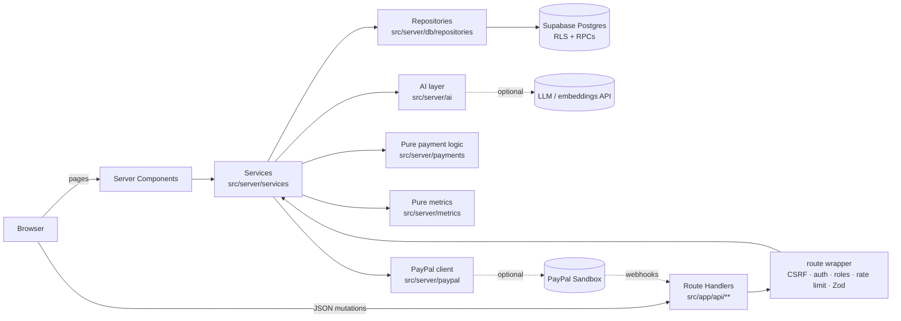
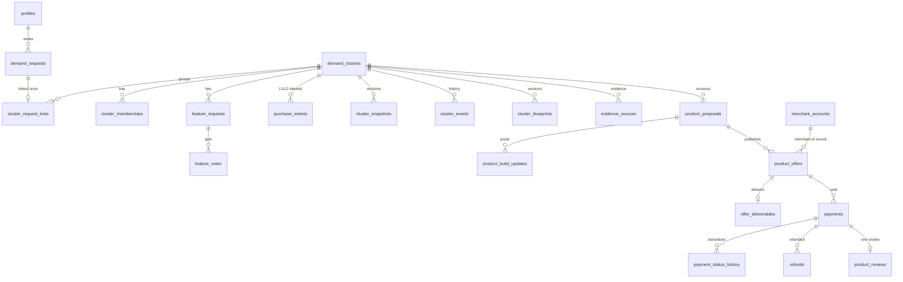
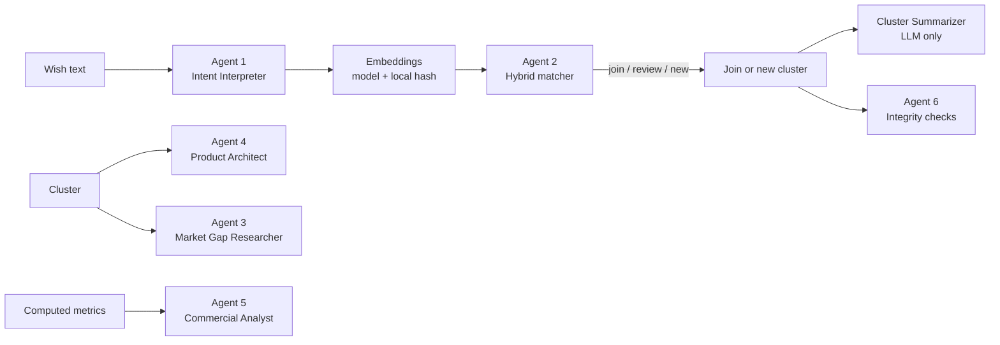
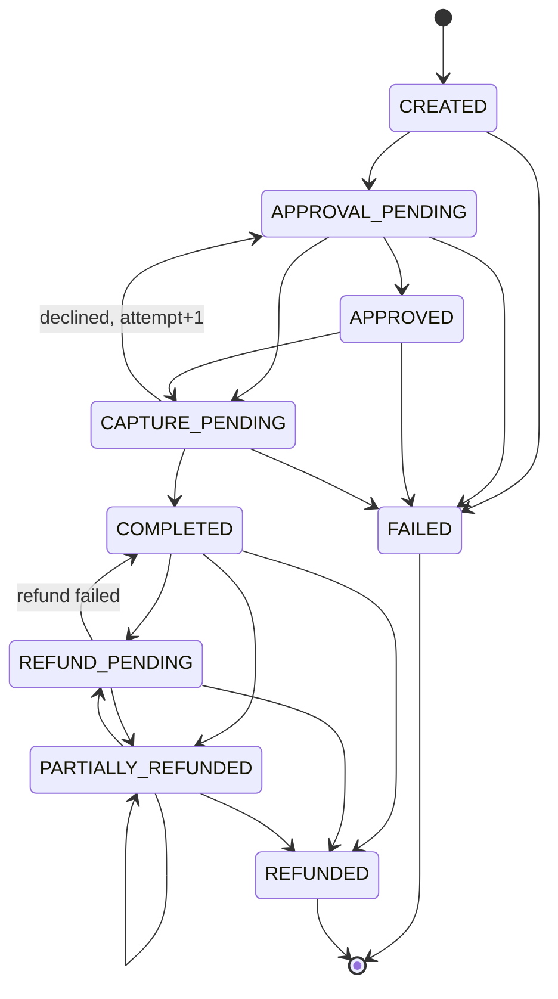

# UNBUILT architecture

UNBUILT is one Next.js 16 App Router application (TypeScript) on top of Supabase (Postgres with pgvector, Auth, Storage). There are no extra services, queues or workers: AI calls, matching, metric refreshes, PayPal calls and webhook processing all run inside request handlers. Three external dependencies are optional and degrade independently:

| Dependency | Without it |
|---|---|
| OpenAI-compatible LLM / embedding API | Deterministic heuristics and local hash embeddings, labelled **Fallback AI** |
| PayPal Sandbox REST credentials | Checkout shows "PayPal Sandbox not configured"; the order API returns 503. Nothing is ever simulated. |
| PayPal webhooks | Synchronous capture plus on-demand reconciliation keep payments correct |

Supabase is required. Local development uses the Supabase CLI stack in Docker.

## 1. Layers

- **Pages** (`src/app/**/page.tsx`) are Server Components that call services directly for reads. Each page segment has a `loading.tsx` skeleton and an `error.tsx` boundary (with `retry()`).
- **Route Handlers** do every mutation. All of them go through `route()` in `src/server/http/handler.ts`: (0) CSRF guard (JSON content type, allowed `Origin`), (1) session + role check, (2) Postgres-backed rate limit (`rate_limit_hit`), (3) strict Zod parsing of body and query, (4) the handler, with a uniform `{ error: { code, message, details? } }` envelope. Unknown errors become a generic 500. There are no Server Actions.
- **Services** (`src/server/services/*.service.ts`) hold the business rules and authorization. Every file under `src/server` starts with `import "server-only"`.
- **Pure modules** (state machine, amounts, order body, refund eligibility, metrics formulas, matcher, constraint compatibility, integrity checks, constellation layout) have no I/O and carry most of the unit tests.
- **Repositories** export an interface and a Supabase implementation; `tests/fakes/*` implement the same interfaces in memory.
- **Clients**: the browser only has the anon key (for Supabase Auth). The server uses a cookie-bound session client for `auth.getUser()` and user-scoped reads, and a service-role client for every write after the service layer authorized it.

`src/proxy.ts` (Next 16 middleware) refreshes the session and redirects signed-out users from `/dashboard`, `/payments`, `/builder/**`, `/admin/**` and `/wish` to `/auth?next=…`. It makes no authorization decisions; APIs check again and answer 401/403.

## 2. Data model

Migrations `supabase/migrations/20261106000001…0009`. Primary keys are UUIDs; money is integer cents; every table has RLS enabled.

Supporting tables: `ai_analysis_runs` (every LLM call, fallback use and matcher run), `moderation_flags`, `notifications`, `audit_logs`, `webhook_events`, `rate_limit_buckets`. The Storage bucket `product-media` holds offer screenshots (public read; writes only through the server).

Key rules:

- A wish's `raw_text` and `structured_intent` are immutable (trigger). User corrections are stored separately and merged into the *effective* intent.
- `demand_clusters` title, description, problem, requirements and constraints change only through the `apply_cluster_change` RPC, which writes a versioned `cluster_snapshots` row each time (the Evolution tab reads these).
- Seeded synthetic rows are `is_demo = true` and labelled **Demo data**. The seed writes no payments.

## 3. AI pipeline

| Agent | LLM output | Fallback |
|---|---|---|
| 1 Intent Interpreter | `IntentSchema` (outcome, capabilities, audience, category, constraint tags, price references) | `heuristic-intent-v1` keyword/regex tables and clause splitting |
| 2 Demand Matcher | `sameUnderlyingNeed` + confidence for the top 3 candidates | deterministic hybrid score only |
| 3 Market Gap Researcher | alternatives (restricted to names users mentioned), gaps, hypotheses; stored as **AI hypothesis, unverified** | frequency table from member intents |
| 4 Product Architect | `BlueprintSchema` blueprint, Markdown export | `blueprint-template-v1` |
| 5 Commercial Analyst | narrative whose numbers must equal supplied metrics (else rejected) | templated narrative |
| 6 Integrity Analyst | `details.aiAssessment` review note on an existing flag | deterministic checks always run |
| Cluster Summarizer | rewrites description/problem after requirements change | none (only the deterministic requirement update) |

The LLM client (`src/server/ai/llm-client.ts`) uses plain `fetch` against any OpenAI-compatible endpoint, `json_object` mode by default, Zod validation with retries, a 7-day cache keyed by input hash, and records every call in `ai_analysis_runs`. Prompt-injection defences: user text is wrapped in `<user_content>` with an instruction to ignore embedded instructions, URLs not present in the input are stripped from output, and reference URLs are stored but never fetched (no SSRF surface). AI output never triggers a payment, a refund or a moderation action.

### Integrity checks (Agent 6)

Run on every submit (same normalized text from another account), join and priced intent (all cluster checks), and from the admin "Run integrity scan" button:

| Flag | Rule | Severity |
|---|---|---|
| `duplicate_text` | same `normalized_text_hash` from ≥ 2 distinct users | medium |
| `repeated_language` | word 5-shingle Jaccard ≥ 0.85 between different users | low |
| `burst_signups` | ≥ 10 joins to one cluster within 1 h from accounts < 24 h old | medium |
| `price_outlier` | stated target > 10× or < 0.1× the cluster median, n ≥ 5 | low |
| `misleading_claim` | offer says the product exists but has no product or demo URL | medium |

Flags use neutral wording ("Possible duplicate"), are deduplicated by a partial unique index on open flags, are never shown publicly and never auto-actioned. Admin resolution (`POST /api/admin/flags/[id]`) can hide the entity, set an account's `trust_weight`, or, for a `capture_mismatch` flag whose payment is `CAPTURE_PENDING`, mark the payment `FAILED` (`failPayment`). Every resolution is audited.

## 4. Matching

1. **Space.** Model embeddings are used only when the request has one *and* every matchable cluster has one for the configured `EMBEDDING_MODEL`; otherwise the local hash space (always complete). The UI says "Matched with local fallback embeddings".
2. **Candidates.** `match_clusters` (top 8 centroids) ∪ clusters of `match_requests` (top 20 member requests). `vectorScore = 0.5·centroidSim + 0.5·maxMemberSim`.
3. **Constraint compatibility.** Conflict pairs (`deployment_offline × deployment_cloud_only`, `privacy_no_data_upload × deployment_cloud_only`, `deployment_self_hosted × deployment_cloud_only`, `deployment_local_first × deployment_cloud_only`, single-platform `platform_mobile × platform_desktop`) make a candidate incompatible (hybrid 0). Otherwise `structured = 0.4·sameCategory + 0.3·jaccard(tags) + 0.3·featureOverlap`.
4. **Hybrid** `= 0.7·vector + 0.3·structured`, banded by thresholds.
5. **Optional LLM classifier** (top 3 compatible candidates above the consider threshold): confidence ≥ 0.7 "different need" demotes to none, ≥ 0.8 "same need" promotes to join, [0.7, 0.8) at least review. It never overrides a constraint conflict.
6. **Join gate.** A join that would link a conflicting wish answers 409 `INCOMPATIBLE_REQUEST`; the UI offers "Join without linking this wish" or "Start a new demand cluster". Cluster tags grow only when ≥ 30 % (and ≥ 3) of linked wishes carry a tag; ≥ 30 % (and ≥ 3) conflicting members open a `split_suggested` flag for an admin.

### Final calibrated thresholds

| Space | Join | Review | LLM consider | Source |
|---|---|---|---|---|
| Local hash embeddings | **0.42** | **0.30** | **0.25** | calibrated on `tests/fixtures/matching-corpus.ts` (design defaults 0.50/0.35/0.30 left two positive probes in review; highest negative probe 0.232, lowest positive 0.431) |
| Model embeddings | 0.66 | 0.48 | 0.40 | design defaults; run `npm run calibrate` with your embedding model and copy the suggested values into `MATCH_*_MODEL` |

`tests/unit/matching.calibration.test.ts` pins the local values: the scene-1 wish joins "Offline AI coding assistant" with ≥ 3 common requirements, the cloud-only IDE probe never joins it, every positive probe is ≥ join, every negative < join. Thresholds are env-overridable (`MATCH_JOIN_THRESHOLD_LOCAL`, …); `consider ≤ review ≤ join` is validated at startup, otherwise defaults are used and `/admin` Health reports it.

**Constellation edges** use centroid cosine ≥ **0.30** in local space (the design's 0.35 drew no edges: the highest seeded cross-cluster similarity is 0.346) and ≥ 0.6 in model space, at most 4 per node.

## 5. Metrics

Pure functions in `src/server/metrics`, cached per cluster in `demand_clusters.metrics_cache` and recomputed when older than the latest cluster event.

- **Unique interested** = distinct members; **price-qualified** = active L2 intents with a target price.
- **WTP** median/percentiles shown only with n ≥ 3; **estimated opportunity** = unique interested × median WTP (labelled **Estimate**), null with too few prices.
- **Weighted demand** weights people by `trust_weight`, account age (accounts younger than 24 h at join are capped), evidence and duplicate text, so duplicate submissions cannot outrank distinct people.
- **Paid buyers / completed Sandbox value** count only payments in `CAPTURED_STATES` (`COMPLETED`, `REFUND_PENDING`, `PARTIALLY_REFUNDED`), minus completed refunds, and are labelled **PayPal Sandbox**. Stated demand and Sandbox money are never added together.

## 6. Payments

### Merchant model

The MVP sells only through one platform merchant, "UNBUILT Demo Merchant (PayPal Sandbox)": the Sandbox business account that owns the REST app. Orders carry no `payee`. Offers of other builders are "Listing only" and cannot be bought; UNBUILT never collects money on behalf of third parties.

### State machine

- The table lives in `src/server/payments/state-machine.ts` and is the only definition. Status changes go through the `advance_payment` RPC (`select … for update`, applies the path only if the status is still the one read). No HTTP route accepts a target status and clients have no write policy on `payments`.
- Capture-side outcomes (`APPROVED`, `CAPTURE_PENDING`, `COMPLETED`) are allowed only from open states. The refund side writes through `apply_refund_outcome` / `recompute_payment_refunds`, whose allowed-from lists are `refundSideAllowedFrom(target) = allowedFrom(target) ∩ CAPTURED_STATES`, so a `CAPTURE_PENDING` payment can never become `COMPLETED` through a refund.
- **Amounts** come from the stored offer only (`POST /api/paypal/orders` accepts `{ offerId }`). Capture verifies status, amount, currency and `custom_id` before `COMPLETED`; a mismatch opens a `capture_mismatch` flag.
- **Idempotency**: `PayPal-Request-Id` = payment idempotency key for create, `<key>-capture-<attempt>` for capture, refund ids for refunds. One open payment per buyer and offer (partial unique index); an open order is reused for 3 h.
- **Reconciliation** (`reconciliation.service.ts`) reads the PayPal order and applies the same verification. It runs on product-page load for open payments, from the checkout's status polling, before a new order, from webhooks and from the admin "Reconcile" button.
- **Webhooks** (`POST /api/webhooks/paypal`) verify the signature with PayPal's API using the raw body byte-for-byte, claim the event in `webhook_events` (duplicates are no-ops), and ignore stale capture events for already captured payments.
- **Refunds**: buyers request; an admin approves (sends the PayPal refund) or rejects; admins can also issue. Eligibility checks the window, remaining amount and open refunds. A refund PayPal did not confirm stays `PENDING` and is retried with the same request id.
- **Delivery**: the deliverable is revealed only to buyers with a payment in `CAPTURED_STATES`, through an allow-listed file key.

### PayPal Operations Copilot (isolated, read-only)

`src/server/paypal-agent/toolkit.ts` is the only adapter to the official `@paypal/agent-toolkit`. Its fixed configuration enables `orders.get`, `payments.getRefunds`, and `transactions.list`; no mutation action is registered. `POST /api/admin/paypal-copilot` is admin-only, CSRF-protected, and separately rate-limited.

The toolkit response passes through an operational-field allowlist before `paypal-operations-copilot.service.ts` sends it to the configured LLM. Payer, email, name, address, shipping, phone, and recipient fields are discarded. The LLM produces an explanation and recommendation only. If AI is unavailable, a deterministic status summary is returned. Every inspection writes an audit entry containing a hash of the resource ID rather than the raw identifier.

This module has no import path into checkout, capture, refund, webhook, or reconciliation services. Those existing services remain the only financial mutation paths.

## 7. Security and RLS

- RLS on every table. The anon key can read only public projections: visible clusters, features (without `created_by`), blueprints, proposals (not withdrawn), published offers, build updates, public profile columns (never `role`, `is_demo`, `trust_weight`), product reviews (never `buyer_id`, `payment_id`).
- Deny-all for clients on `cluster_events`, `cluster_request_links`, `evidence_sources`, `cluster_snapshots`, `offer_deliverables`, `merchant_accounts`, `ai_analysis_runs`, `moderation_flags`, `audit_logs`, `webhook_events`, `rate_limit_buckets`, `payment_status_history`. Pages read them through the service client with projections that omit user ids.
- Own-row reads only for requests, memberships, intents, votes, payments, refunds, notifications (clients may update only `notifications.read_at`).
- Admin cannot be self-assigned at sign-up (trigger). Roles are read server-side through the service client.
- CSRF: JSON-only mutations from allowed origins. Rate limits per user or hashed IP. All user text renders as escaped React text; `react/no-danger` is a lint error; blueprint Markdown renders with HTML disabled and http(s)/mailto links only.
- Secrets (`SUPABASE_SERVICE_ROLE_KEY`, `PAYPAL_CLIENT_SECRET`, `LLM_API_KEY`) are server-only; `/admin` Health and `npm run check:env` report capability flags, never values.
- Screenshot uploads: owner only, png/jpeg/webp checked by file signature, ≤ 2 MB, ≤ 6 per offer, stored at `<builderId>/<uuid>.<ext>` with the service role; the bucket has no client write policy.

## 8. Fallbacks and failure handling

- LLM unavailable or invalid JSON after retries → the agent's deterministic fallback, recorded as a `fallback` run with `fallbackReason`.
- Embedding API failure → local hash embeddings (the local vector is always stored).
- Matching throws → the wish stays stored with `recommendation: "retry"`; the UI retries through `POST /api/ai/match`.
- Post-commit steps of a join (requirements, summarizer, split check, centroid, metrics, notifications, integrity checks) are best-effort and logged; metrics recompute on the next read.
- PayPal timeouts leave the payment in `CAPTURE_PENDING`; reconciliation re-captures after 30 s with the same request id, so it never blocks a re-buy or double-charges.

## 9. Extension points (P2, documented only)

P2 items are not implemented in this build. Partial UI would break the "no hidden unfinished buttons" rule, so none of these appear in the app.

| P2 item | Where it plugs in |
|---|---|
| External research provider for Agent 3 | A `ResearchProvider` interface in `src/server/ai/agents/market-gap-researcher.ts` returning sourced evidence; results stored as `evidence_sources(source_type='external_research', verification_status='unverified')`. Today only user evidence and labelled AI hypotheses exist. |
| Trend analysis, forecasting | New pure modules next to `src/server/metrics/formulas.ts` reading `cluster_events`; output must be labelled **Estimate**. |
| Email notifications | A second channel inside `notification.service.notify` (in-app rows already carry `{title, body, href}`). |
| Advanced fraud models | Additional checks in `src/server/ai/agents/integrity-analyst.ts`; they open flags only. |
| PayPal multiparty seller onboarding | `buildOrderBody` in `src/server/payments/order-body.ts` throws for `merchant.kind = 'seller'`; onboarding would set `merchant_accounts.paypal_merchant_id` and add `payee`. |
| Recurring billing | A new offer type plus PayPal Subscriptions; the payment state machine is one-time only. |
| International currencies | `PAYPAL_CURRENCY` accepts only USD; amounts are already integer minor units. |
